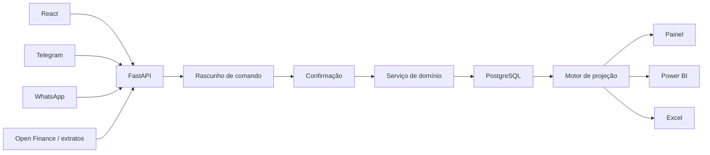

# Modelo de dados e integrações

## Direção arquitetural

Quando a aplicação estiver operacional:

- PostgreSQL será a fonte oficial.
- FastAPI concentrará regras de negócio.
- React, Telegram, WhatsApp e importadores usarão a mesma API.
- Excel será importação, exportação e relatório baixável.
- Power BI consumirá tabelas ou views analíticas.

Não usar o arquivo Excel como banco concorrente para vários usuários ou integrações.

## Entidades principais

### Núcleo financeiro

```text
users
accounts
balance_snapshots
categories
transactions
transfers
```

### Obrigações

```text
debts
debt_offers
agreements
installment_plans
installments
recurring_rules
```

### Análise

```text
budget_policies
financial_events
forecast_snapshots
scenario_runs
audit_events
```

## Campos essenciais

### Transaction

```text
id
user_id
account_id
type
amount
occurred_at
category_id
description
payment_method
status
installment_id
recurring_rule_id
source
external_id
created_at
updated_at
```

### InstallmentPlan

```text
id
user_id
description
total_amount
installment_count
installment_amount
first_due_date
account_id
category_id
status
```

### Installment

```text
id
plan_id
number
due_date
amount
status
paid_transaction_id
paid_at
```

### Debt

```text
id
user_id
creditor
original_amount
current_balance
due_date
status
priority
agreement_id
```

### BalanceSnapshot

```text
id
account_id
balance
as_of
source
external_id
```

### Account

```text
id
user_id
name
account_type
cash_equivalent
spend_scope
active
```

`account_type` pode distinguir conta bancária, dinheiro, cartão de crédito e carteira de benefício. Uma carteira de vale-alimentação possui `cash_equivalent=false` e `spend_scope=food`.

### RecurringRule

```text
id
user_id
flow_kind
amount
start_date
end_date
day
account_id
cash_impact
confidence
active
```

`flow_kind` deve separar `income`, `expense` e `restricted_benefit`. O motor de caixa considera apenas regras com `cash_impact=true`.

## API inicial

```text
POST /transactions
POST /transfers
POST /debts
POST /debt-offers
POST /agreements
POST /installment-plans
POST /installments/{id}/pay
POST /recurring-rules
POST /accounts/{id}/balance-snapshots

GET /dashboard
GET /forecast
GET /cash-flow
GET /debts
GET /financial-health
GET /exports/excel
```

### Parâmetros de consulta da previsão

`GET /forecast` e `GET /dashboard` devem aceitar uma janela explícita:

```text
horizon=1m | 3m | 6m | 12m | custom
window_start=YYYY-MM-DD
window_end=YYYY-MM-DD
scenario=control | current | attack
```

`window_end` controla somente a leitura da projeção. Regras de renda mantêm seu próprio `end_date` ou `valid_until`; selecionar uma janela anual nunca autoriza repetir salário além da data confirmada.

Uma resposta resumida deve incluir:

```text
window_start
window_end
months
salary_income
other_cash_income
restricted_benefits
cash_outflows
net_result
ending_balance
minimum_balance
free_after_reserve
months_below_reserve
income_valid_until
projection_coverage_status
```

## Fluxo multicanal



## Camada de projeção

O motor deve receber:

- último saldo confirmado por conta;
- eventos realizados posteriores ao saldo;
- parcelas pendentes;
- recorrências pendentes;
- eventos avulsos;
- orçamento variável restante;
- cenário selecionado.

Deve devolver:

- resultado mensal;
- saldo final acumulado;
- menor saldo dentro da janela consultada;
- livre após reserva;
- receitas em caixa separadas de benefícios restritos;
- salários separados de outras receitas;
- quantidade de meses abaixo da reserva;
- data até a qual a renda recorrente está confirmada;
- status de cobertura quando a janela solicitada exceder a projeção disponível;
- compromissos sem cobertura;
- dívida restante;
- data estimada de quitação.

## Indicadores de endividamento

O modelo analítico deve distinguir:

```text
recognized_debt
pending_offer_original_balance
pending_offer_max_savings
expanded_debt_original
discounted_settlement_scenario
```

Fórmulas conceituais:

```text
expanded_debt_original =
    recognized_debt
    + pending_offer_original_balance

discounted_settlement_scenario =
    expanded_debt_original
    - pending_offer_max_savings
```

`discounted_settlement_scenario` é uma simulação. Não deve ser persistido como dívida contratada nem participar do fluxo de caixa. Ao aceitar uma oferta, a operação deve substituir a obrigação anterior pelo acordo e remover a proposta do conjunto pendente de forma atômica.

## Indicadores de receita e resultado

O modelo analítico deve expor:

```text
forecast_income_high_medium_confidence
forecast_income_low_confidence
forecast_income_total
forecast_outflows_and_reserves
forecast_net_result
restricted_benefit_monthly
restricted_benefit_forecast
economic_resources_total
```

Fórmulas conceituais:

```text
forecast_income_total =
    forecast_income_high_medium_confidence
    + forecast_income_low_confidence

forecast_net_result =
    forecast_income_total
    - forecast_outflows_and_reserves

economic_resources_total =
    forecast_income_total
    + restricted_benefit_forecast
```

Cada indicador deve carregar `horizon_start`, `horizon_end`, `as_of`, `scenario` e `confidence_basis`. O saldo final continua sendo calculado separadamente como saldo inicial mais resultado líquido acumulado.
`economic_resources_total` não é caixa livre e não deve alimentar saldo bancário, cobertura de dívidas ou patrimônio financeiro líquido sem uma classificação própria.

## Power BI

### Fatos

```text
FactTransactions
FactInstallments
FactBalances
FactForecast
FactDebts
FactRestrictedBenefits
```

### Dimensões

```text
DimDate
DimAccount
DimCategory
DimCreditor
DimStatus
DimUser
DimResourceType
```

Não misturar valores realizados e previstos sem uma coluna de cenário/status clara.
Expor os indicadores de endividamento com uma dimensão ou coluna de camada (`recognized`, `expanded_original`, `discounted_scenario`) para que o relatório não some cenários entre si.
Nas receitas, permitir análise por confiança e impedir que receita total, resultado líquido e saldo final sejam somados como se fossem a mesma métrica.
Benefícios restritos devem ser analisados por finalidade e carteira, sem serem somados ao caixa. `DimResourceType` deve distinguir caixa, crédito, benefício restrito e cenário.

## Excel baixável

O backend pode gerar um `.xlsx` com:

- dados normalizados;
- saldos;
- dívidas e parcelas;
- recorrências;
- projeção;
- cenários;
- painel.

O arquivo exportado deve registrar data-base, versão do modelo, cenário e a definição das camadas de endividamento.

## Open Finance

Evolução recomendada:

1. Importação manual de CSV/PDF.
2. Importação bancária estruturada.
3. Integração Open Finance somente leitura.
4. Conciliação automática assistida.
5. Sugestões de correspondência entre transações, parcelas e recorrências.

Requisitos:

- consentimento explícito;
- possibilidade de revogação;
- criptografia;
- segregação por usuário;
- auditoria;
- minimização de dados;
- tratamento compatível com LGPD.
