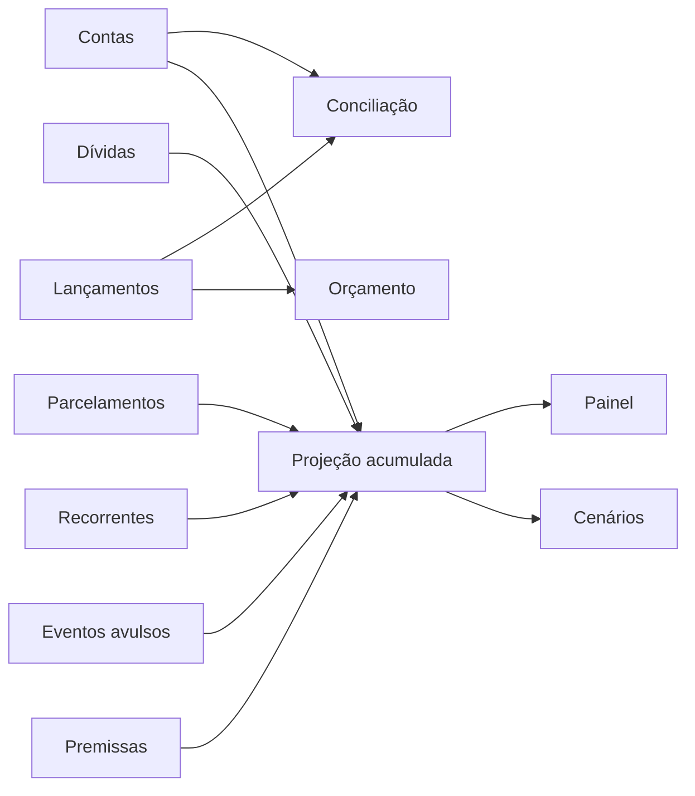

# Controle financeiro — visão funcional

## Propósito

O objetivo é construir uma visão orgânica da saúde financeira:

- registrar o que realmente aconteceu;
- controlar obrigações já assumidas;
- estimar o que acontecerá;
- comparar o previsto com o realizado;
- mostrar quanto está verdadeiramente livre;
- apoiar decisões sobre gastos, dívidas, reserva e renda.

A planilha é o protótipo funcional. No futuro, a aplicação será a principal interface e o Excel continuará como arquivo baixável e auditável.

## Modelo mental

Existem quatro tipos de informação:

1. **Fato:** algo que já aconteceu, como uma compra ou salário recebido.
2. **Compromisso:** obrigação assumida, como uma parcela ou dívida.
3. **Premissa:** hipótese editável, como salário futuro ou limite de gastos.
4. **Cenário:** simulação que não altera os fatos.

O usuário registra fatos, compromissos e premissas. O sistema calcula projeções e cenários.

## Fluxo da planilha



## Fórmulas conceituais

### Resultado do mês

```text
receitas recorrentes
+ receitas avulsas
- parcelas
- despesas recorrentes
- despesas avulsas
- orçamento variável restante
```

### Saldo final projetado

```text
saldo inicial do mês + resultado previsto do mês
```

O saldo final de um mês é o saldo inicial do mês seguinte.

### Livre após reserva

```text
saldo final projetado - reserva mínima
```

### Conciliação

```text
diferença = saldo bancário informado - saldo calculado
```

A diferença ideal é zero.

## Rotina recomendada

### No dia a dia

1. Registrar receitas, despesas e transferências.
2. Relacionar pagamentos a parcelas ou recorrências quando aplicável.
3. Atualizar saldo bancário e data em `Contas`.
4. Conferir `Conciliacao`.

### Semanalmente

1. Revisar gastos não essenciais.
2. Conferir próximos vencimentos.
3. Comparar previsto e realizado.
4. Identificar impacto de novos gastos sobre os meses seguintes.

### Mensalmente

1. Fechar a conciliação.
2. Atualizar `Parcelas pagas`.
3. Revisar salário e recorrências futuras.
4. Atualizar saldos de dívidas.
5. Comparar cenários e estratégia de quitação.

## Camadas de endividamento

O sistema apresenta três leituras complementares:

1. **Dívida reconhecida:** dívidas ativas mais o saldo restante dos parcelamentos.
2. **Dívida ampliada — saldo original:** dívida reconhecida mais os saldos informados nas propostas ainda não aceitas.
3. **Quitação com descontos máximos:** dívida reconhecida mais os saldos das propostas, descontando somente a economia máxima informada.

```text
dívida ampliada = dívida reconhecida + saldos originais das ofertas pendentes

quitação com descontos = dívida ampliada - economia máxima informada
```

A terceira leitura é um cenário estimado. Ela não altera caixa, compromissos ou projeção enquanto a oferta não for contratada. Se uma proposta for aceita, o novo acordo substitui a obrigação original para impedir dupla contagem.

## Receitas e geração de caixa

O horizonte da previsão também possui cinco indicadores:

1. **Receitas de alta/média confiança:** salário confirmado ou projetado por uma premissa com confiança conhecida.
2. **Receitas de baixa confiança:** entradas estimadas que ainda precisam de confirmação, como o 13º.
3. **Receita total estimada:** soma de todas as entradas previstas no horizonte.
4. **Saídas e reservas previstas:** parcelas, despesas recorrentes, eventos avulsos e orçamento variável reservado.
5. **Resultado líquido estimado:** quanto as receitas aumentam o caixa depois das saídas e reservas.

```text
receita total estimada =
    receitas de alta/média confiança
    + receitas de baixa confiança

resultado líquido estimado =
    receita total estimada
    - saídas e reservas previstas

saldo final projetado =
    saldo inicial
    + resultado líquido estimado
```

Receita total não representa dinheiro livre. Para decidir sobre compras, antecipações ou metas, use o resultado líquido junto do saldo final projetado e da reserva mínima.

## Janelas móveis de análise

O `Painel` permite analisar a projeção em cinco janelas:

1. **Mensal:** 1 mês.
2. **Trimestral:** 3 meses.
3. **Semestral:** 6 meses.
4. **Anual:** 12 meses.
5. **Personalizado:** data final informada em `Premissas`.

A janela começa no primeiro mês disponível em `Projecao`. O modo personalizado é limitado ao último mês já calculado nessa aba. A projeção mensal continua sendo a única fonte; as janelas apenas agregam os meses, sem criar lançamentos ou duplicar parcelas.

O resumo da janela mostra:

- salários projetados;
- outras receitas em caixa;
- receita total em caixa;
- vale-alimentação previsto;
- saídas e reservas;
- resultado líquido;
- saldo final;
- menor saldo do período;
- livre após reserva;
- quantidade de meses abaixo da reserva.

O horizonte selecionado não prolonga automaticamente a renda. O salário só se repete até `Renda atual prevista até`. Por exemplo, a janela anual pode alcançar julho de 2027 e ainda assim considerar salário apenas até dezembro de 2026. Essa separação evita transformar emprego incerto em renda garantida.

```text
resultado líquido da janela =
    receitas em caixa da janela
    - saídas e reservas da janela

saldo final da janela =
    saldo inicial disponível
    + resultado líquido acumulado

menor saldo da janela =
    menor saldo final mensal dentro do período
```

### 13º proporcional

O 13º deve ser tratado como uma receita de baixa confiança enquanto o valor líquido e as datas não forem confirmados. A estimativa atual usa:

```text
13º líquido conservador =
    salário bruto contratual
    × avos estimados / 12
    × fator líquido conservador
```

O fator líquido conservador é a relação observada entre o salário líquido e o salário bruto. Ele serve para planejamento, não substitui o cálculo do empregador.

## Benefícios restritos e recursos econômicos

Vale-alimentação e benefícios semelhantes são recursos de uso limitado. Eles podem preservar o dinheiro da conta ao substituir gastos elegíveis, mas não podem ser somados ao saldo bancário ou usados diretamente para pagar dívidas.

O modelo apresenta separadamente:

1. benefício mensal;
2. benefício previsto no horizonte;
3. receitas em caixa;
4. recursos econômicos totais.

```text
recursos econômicos totais =
    receitas em caixa
    + benefícios restritos previstos
```

Esse total mede recursos disponíveis para finalidades diferentes. Para decisões de caixa, continuam valendo o resultado líquido, o saldo final projetado e a reserva mínima.

## Interpretação correta

- Saldo em conta não é igual a dinheiro livre.
- Dinheiro livre deve descontar reserva e compromissos.
- Dívida sem pagamento agendado pode não aparecer no fluxo, mas continua existindo.
- Projeções são condicionais: mudam quando entradas, gastos ou premissas mudam.
- Desconto ainda não contratado não deve ser tratado como economia realizada.
- A visão ampliada mede exposição potencial; não significa que todas as ofertas já foram contratadas.
- Uma receita de baixa confiança deve permanecer visível, mas não deve ser tratada como garantida.
- Benefício restrito reduz gastos elegíveis, mas não aumenta o saldo bancário.
